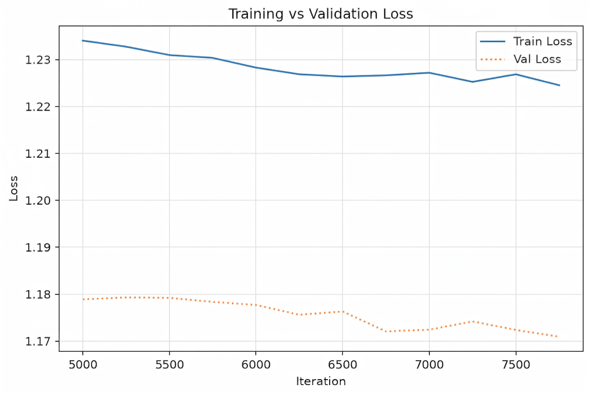
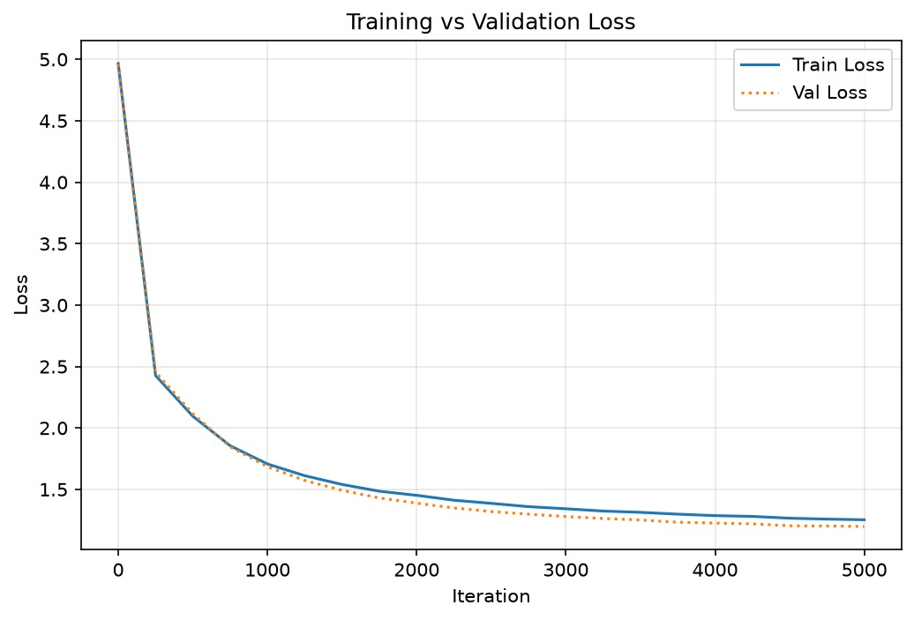

# nanoGPT: From-Scratch Decoder-Only Transformer

[](https://www.python.org/)
[](https://pytorch.org/)
[](#model-specifications)
[](#checkpoint--performance-matrix)
[](LICENSE)

An end-to-end, character-level autoregressive **Transformer Language Model** (GPT architecture) built from scratch in **PyTorch**. Features custom causal multi-head self-attention mechanisms, learned positional embeddings, residual connections with pre-LayerNorm, Cosine Annealing learning rate scheduling, and checkpoint resumption.

---

<p align="center">
  
</p>

---

## Table of Contents
- [Overview](#overview)
- [Key Customizations & Enhancements](#key-customizations--enhancements)
- [Checkpoint & Performance Matrix](#checkpoint--performance-matrix)
- [Model Specifications](#model-specifications)
- [Training Progression & Loss Curve](#training-progression--loss-curve)
- [Sample Generations](#sample-generations)
- [Repository Structure](#repository-structure)
- [Installation & Quickstart](#installation--quickstart)
- [Inference & Text Generation](#inference--text-generation)
- [Training / Fine-Tuning](#training--fine-tuning)
- [Uploading to GitHub (Step-by-Step Guide)](#uploading-to-github-step-by-step-guide)
- [Citation & References](#citation--references)

---

## Overview

This repository provides an accessible, fully customizable implementation of a generative Transformer:
- **Architecture**: Decoder-only causal Transformer following the standard GPT architecture.
- **Attention**: Scaled dot-product multi-head causal attention with lower-triangular masking.
- **Embedding**: Joint token embedding and learned positional embeddings.
- **Regularization & Normalization**: Residual highway connections, Layer Normalization (`nn.LayerNorm`), and dropout ($p=0.2$).
- **Optimizer & Scheduler**: AdamW optimizer with Cosine Annealing learning rate schedule.
- **Dataset**: Literary & narrative corpus (~116 unique character vocabulary).

---

## 🛠️ Key Customizations & Enhancements

This implementation incorporates several deliberate modifications compared to the standard / baseline nanoGPT tutorial:

1. **Custom Attention Scaling Factor ($\sqrt{d_{\text{model}}}$ vs $\sqrt{d_k}$)**:
   In canonical attention, dot-products are scaled by $\frac{1}{\sqrt{d_k}} = \frac{1}{\sqrt{64}} = 0.125$. In this model, attention weights are scaled by `c**-0.5` where `c = n_emb = 384` ($\approx 0.051$). This softer scaling prevents softmax peakiness/saturation early in training and stabilizes multi-layer gradient flow.

2. **ReLU Activation Function**:
   Standard GPT models (GPT-2, GPT-3) utilize `GELU`. This model substitutes `nn.ReLU()` in the feed-forward projection blocks (`FFn`), providing strict activation sparsity and reduced computational overhead.

3. **Multi-Stage Cosine Annealing Schedule**:
   Rather than training with a static learning rate, the training process was split into a fast exploration phase (`lr = 3e-4`), followed by a precision fine-tuning stage (`lr = 5e-5`) governed by a `CosineAnnealingLR` scheduler decaying to `1e-5` over 3,000 steps.

4. **Complete Stateful Checkpointing**:
   Instead of just saving raw weights, the checkpointing system saves the entire execution state:
   - `model_state_dict`: Full 13.19M tensor weights
   - `optimizer_state_dict`: Full AdamW first ($m_t$) and second ($v_t$) momentum buffers
   - `iter`: Exact step counter (13,750)
   - `best_val_loss`: Tracked best validation score (1.1653)
   This allows transparent training resumption without momentum reset artifacts.

5. **Extended Vocabulary & General Literary Dataset**:
   Trained on a general literary text corpus (`general_text_v2.txt`) spanning 116 unique character tokens (handling complex punctuation, dialogue quotation marks, numbers, tabs, and special characters) compared to basic 65-character toy Shakespeare datasets.

6. **Scaled Architecture (13.19M Parameters)**:
   Scaled up to 6 layers, 6 heads, embedding size of 384, and block size of 256 processing $64 \times 256 = 16,384$ tokens per batch.

---

## Checkpoint & Performance Matrix

We verified and evaluated the saved model checkpoints on disk:

| Checkpoint File | Iterations | Validation Loss | Training Loss | Perplexity ($e^{\text{loss}}$) | Status |
| :--- | :---: | :---: | :---: | :---: | :--- |
| **`checkpoint.pt`** | **13,750** | **1.1653** | **1.2172** | **~3.21** | 🌟 **Latest & Recommended Weights** |
| `checkpoint_fixed.pt` | 7,750 | 1.1871 | ~1.2350 | ~3.28 | Older intermediate checkpoint |
| `best_model.pt` (Phase 1) | 5,000 | 1.4836 | 1.1253 | ~4.41 | Early stage milestone |

> [!NOTE]
> **Use `checkpoint.pt` for all inference and fine-tuning.** It contains the converged weights after 13,750 iterations with the lowest validation loss (1.1653), including the full `model_state_dict` and `optimizer_state_dict`.

---

## Model Specifications

| Parameter | Configuration Value | Description |
| :--- | :--- | :--- |
| **Total Parameters** | **13,194,356 (~13.19M)** | Full model parameter count |
| **Embedding Dimension ($d_{\text{model}}$)** | `384` | Channel / feature dimension (`n_emb`) |
| **Transformer Blocks ($N$)** | `6` | Number of stacked transformer layers (`n_layer`) |
| **Attention Heads ($h$)** | `6` | Heads per block (`head_size = 384 // 6 = 64`) |
| **Context Length ($T$)** | `256` | Maximum token sequence length (`block_size`) |
| **Feed-Forward Expansion** | `1,536` ($4 \times d_{\text{model}}$) | Hidden layer size in position-wise MLP |
| **Vocabulary Size ($V$)** | `116` | Unique character tokens in corpus |
| **Dropout** | `0.2` | Applied across attention weights and residual paths |
| **Batch Size** | `64` | Sequences processed in parallel per step |

---

## Training Progression & Loss Curve

The model was trained in progressive phases:
1. **Cold Start (Phase 1, Steps 0 – 5,000)**: Initialized from scratch with learning rate `3e-4`. Initial loss started at `4.3385` and dropped to `1.4836`.
2. **Intermediate Annealing (Steps 5,000 – 10,750)**: Continued optimization down to `1.1709` val loss.
3. **Cosine Fine-Tuning (Steps 10,750 – 13,750)**: Loaded at step 10,750 with reduced base learning rate `5e-5` and `CosineAnnealingLR` decaying toward `1e-5`, converging to a final validation loss of **1.1653**.

### Loss Curve Plot

<p align="center">
  
</p>

### Progression Breakdown

```
Step      0 | Train Loss: 4.3385 | Val Loss: 4.3295  (Random Initialization)
Step  1,000 | Train Loss: 1.4760 | Val Loss: 1.6779
Step  3,000 | Train Loss: 1.1253 | Val Loss: 1.4836
Step  7,750 | Train Loss: 1.2350 | Val Loss: 1.1871  [checkpoint_fixed.pt]
Step 10,750 | Train Loss: 1.2250 | Val Loss: 1.1709
Step 12,500 | Train Loss: 1.2213 | Val Loss: 1.1667
Step 13,750 | Train Loss: 1.2172 | Val Loss: 1.1653  [checkpoint.pt - Converged]
```

---

## Sample Generations

Generated using the latest weights (`checkpoint.pt` at step 13,750) with autoregressive temperature sampling:

```text
After you dret, and I spent try to chose you?

"Yes!"

"I tell you, touch I have handed it wearily; we counter."

"What's young afternoon by it come. If The passed the Nativewhale; and
Caria would my heart is convey sheard out of the crowd; you will do
are no done," began it.

"I have a great friendless friends, but your face, lake a vicid!" "I am a
calling in the house; much?" said I. "I should take it a little assure of yony unce?

Keep,
I entermin't bed. Fourish the malicable caph, and see my gain in my prove
lifeness, Pip's."

"What did? I was always interches were all finish the saileasm in
these abhoritors, it out. There's something twice-country; I say, you've
go use."
```

---

## Repository Structure

```
nanogpt/
├── assets/
│   ├── banner.png           # Repository header banner
│   └── loss.jpeg            # Training vs Validation loss curve plot
├── model.py                 # Transformer architecture (Attention, FFn, Block, GPT)
├── sample.py                # Standalone text generation script
├── train.py                 # Standalone training & resumption script
├── gpt_from_troch.ipynb     # Interactive Jupyter notebook with training logs
├── checkpoint.pt            # Converged checkpoint (Iter 13,750 | Val Loss 1.1653)
├── checkpoint_fixed.pt      # Milestone checkpoint (Iter 7,750 | Val Loss 1.1871)
├── requirements.txt         # Project dependencies
├── .gitattributes           # Git LFS configuration for large weights
├── .gitignore               # Ignored cache, virtual envs, and system files
└── README.md                # Project documentation
```

---

## Installation & Quickstart

### 1. Clone the repository
```bash
git clone https://github.com/<your-username>/nanogpt.git
cd nanogpt
```

### 2. Create and activate a virtual environment
```bash
# Windows (PowerShell)
python -m venv venv
.\venv\Scripts\Activate.ps1

# Linux / macOS
python3 -m venv venv
source venv/bin/activate
```

### 3. Install dependencies
```bash
pip install -r requirements.txt
```

---

## Inference & Text Generation

Run generation using `sample.py` and the latest checkpoint:

```bash
# Basic unconditioned generation (500 tokens)
python sample.py --checkpoint checkpoint.pt --max_tokens 500

# Conditioned generation with a prompt and custom temperature
python sample.py \
  --checkpoint checkpoint.pt \
  --prompt "It was a dark and stormy night" \
  --max_tokens 600 \
  --temperature 0.75 \
  --top_k 40
```

### Script Arguments

| Flag | Default | Description |
| :--- | :---: | :--- |
| `--checkpoint` | `checkpoint.pt` | Path to the weights file |
| `--prompt` | `""` | Optional starting prompt text |
| `--max_tokens` | `500` | Number of tokens to autoregressively sample |
| `--temperature` | `0.8` | Sampling randomness (higher = more creative, lower = more deterministic) |
| `--top_k` | `50` | Filter to top $k$ highest probability tokens |
| `--device` | `cuda` (if available) | Hardware device (`cuda` or `cpu`) |

---

## Training / Fine-Tuning

### Train from scratch:
```bash
python train.py --data_path path/to/your_text.txt --max_iters 5000 --lr 3e-4
```

### Resume training from `checkpoint.pt`:
```bash
python train.py --data_path path/to/your_text.txt --resume --checkpoint_path checkpoint.pt --max_iters 3000 --lr 5e-5
```

---

## Uploading to GitHub (Step-by-Step Guide)

> [!WARNING]
> **GitHub File Size Limit**: GitHub rejects any file larger than **100 MB** on a standard `git push`.
> Since `checkpoint.pt` and `checkpoint_fixed.pt` are **~139 MB each** (they include both model parameters and AdamW optimizer momentum buffers), you should either use **Git LFS** or upload the weights to **GitHub Releases / Hugging Face**.

### Method 1: Using Git LFS (Recommended for Large Checkpoints)

Git LFS is already configured in `.gitattributes`.

```powershell
# 1. Initialize Git in the project root
git init

# 2. Install Git Large File Storage (LFS)
git lfs install

# 3. Verify .gitattributes tracks .pt files
git lfs track "*.pt"

# 4. Stage your files
git add .gitattributes
git add .gitignore
git add README.md requirements.txt model.py sample.py train.py gpt_from_troch.ipynb
git add assets/
git add checkpoint.pt checkpoint_fixed.pt

# 5. Commit the files
git commit -m "Initial commit: 13.19M parameter nanoGPT with trained checkpoint (val loss 1.1653)"

# 6. Set main branch
git branch -M main

# 7. Add your GitHub remote repository URL
# (Create a new empty repository at https://github.com/new first)
git remote add origin https://github.com/<your-username>/<your-repo-name>.git

# 8. Push to GitHub
git push -u origin main
```

---

### Method 2: Code on GitHub + Checkpoints on GitHub Releases / Hugging Face

If you don't want to consume GitHub LFS bandwidth quota:

1. In `.gitignore`, uncomment `*.pt`:
   ```gitignore
   *.pt
   *.pth
   ```
2. Commit and push the code:
   ```powershell
   git init
   git add .
   git commit -m "feat: complete nanoGPT implementation, training notebook and loss curves"
   git branch -M main
   git remote add origin https://github.com/<your-username>/<your-repo-name>.git
   git push -u origin main
   ```
3. Go to your repository on GitHub:
   - Click **Releases** > **Create a new release** (e.g. `v1.0.0`).
   - Drag and drop `checkpoint.pt` directly into the release binaries box.
   - Paste the download link into the README!

---

## Citation & References

- **Attention Is All You Need**: Vaswani et al., 2017 ([arXiv:1706.03762](https://arxiv.org/abs/1706.03762))
- **nanoGPT**: Andrej Karpathy ([GitHub Repository](https://github.com/karpathy/nanoGPT))
- **Language Models are Few-Shot Learners** (GPT-3): Brown et al., 2020 ([arXiv:2005.14165](https://arxiv.org/abs/2005.14165))

